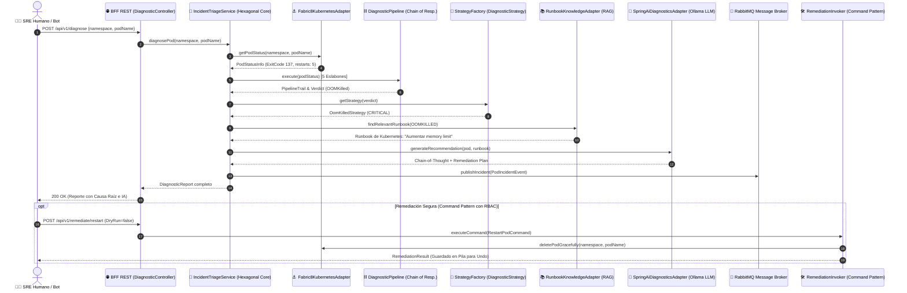

# 🛡️ KubeGuardian AI — Guía Maestra de Arquitectura, Flujo Completo y Crónica SRE
> **Autor**: Juan Vargas — Senior Backend & Cloud-Native Architect  
> **Propósito**: Manual de estudio exhaustivo y preparación para entrevistas técnicas de alto nivel.  
> Explica el recorrido exacto de ejecución paso a paso, con nombres de clases, métodos, rutas de archivos y justificación técnica en español claro.

---

## 📖 0. La Odisea de un Pod: Crónica de un Rescate en Kubernetes con KubeGuardian AI

> *"Eran las 03:14 AM cuando el clúster guardó silencio. No un silencio de paz, sino el preludio del desastre. En el namespace `default`, un pod vital para la facturación —el infame `demo-oomkilled-service`— acababa de perecer. Su contenedor yacía inerte con el temido Exit Code 137. ¿Quién acudiría al rescate antes de que el negocio colapsara? Esta es la crónica viva de cómo KubeGuardian AI orquesta cada capa, puerto y patrón de diseño para salvar el día."*



### 🎭 El Drama en 8 Actos:

1. **Acto I: La Alarma en la Frontera (Driving Adapters / REST BFF)**:
   La petición entra por [`DiagnosticController.java`](file:///d:/Documents/Proyectos/kubesynapse-ai/src/main/java/com/juanvargas/kubesynapse/infrastructure/adapter/in/web/DiagnosticController.java) o por la terminal interactiva [`KubeCkaCliAdapter.java`](file:///d:/Documents/Proyectos/kubesynapse-ai/src/main/java/com/juanvargas/kubesynapse/infrastructure/adapter/in/cli/KubeCkaCliAdapter.java). El controlador web no contiene lógica de negocio; es un mero traductor HTTP que delega la intención al caso de uso del dominio: [`DiagnosePodUseCase`](file:///d:/Documents/Proyectos/kubesynapse-ai/src/main/java/com/juanvargas/kubesynapse/domain/port/in/DiagnosePodUseCase.java).
2. **Acto II: El Vuelo del Navegante hacia el Clúster (Driven Adapter / Fabric8)**:
   El orquestador central, [`IncidentTriageService.java`](file:///d:/Documents/Proyectos/kubesynapse-ai/src/main/java/com/juanvargas/kubesynapse/domain/service/IncidentTriageService.java), invoca el puerto de salida [`KubernetesPort`](file:///d:/Documents/Proyectos/kubesynapse-ai/src/main/java/com/juanvargas/kubesynapse/domain/port/out/KubernetesPort.java). Sin tocar la API directa de Kubernetes, la implementación [`Fabric8KubernetesAdapter.java`](file:///d:/Documents/Proyectos/kubesynapse-ai/src/main/java/com/juanvargas/kubesynapse/infrastructure/adapter/out/k8s/Fabric8KubernetesAdapter.java) viaja por HTTPS seguro hacia Minikube y extrae la radiografía completa del paciente: [`PodStatusInfo`](file:///d:/Documents/Proyectos/kubesynapse-ai/src/main/java/com/juanvargas/kubesynapse/domain/model/PodStatusInfo.java) (estado, fase, cgroups, Exit Code y últimos 100 renglones de logs).
3. **Acto III: La Balanza de la Verdad (Chain of Responsibility Pattern)**:
   Los datos son arrojados al foso de [`DiagnosticPipeline.java`](file:///d:/Documents/Proyectos/kubesynapse-ai/src/main/java/com/juanvargas/kubesynapse/domain/pattern/chain/DiagnosticPipeline.java). Cinco guardianes se pasan la evidencia uno tras otro:
   - *Eslabón 1 ([`PodExistenceHandler`](file:///d:/Documents/Proyectos/kubesynapse-ai/src/main/java/com/juanvargas/kubesynapse/domain/pattern/chain/PodExistenceHandler.java))*: "¿El pod existe o es un fantasma?"
   - *Eslabón 2 ([`PodPhaseHandler`](file:///d:/Documents/Proyectos/kubesynapse-ai/src/main/java/com/juanvargas/kubesynapse/domain/pattern/chain/PodPhaseHandler.java))*: "¿Está en fase Pending o Failed?"
   - *Eslabón 3 ([`ContainerRestartHandler`](file:///d:/Documents/Proyectos/kubesynapse-ai/src/main/java/com/juanvargas/kubesynapse/domain/pattern/chain/ContainerRestartHandler.java))*: "¿Cuántas veces ha reiniciado?"
   - *Eslabón 4 ([`OomKilledHandler`](file:///d:/Documents/Proyectos/kubesynapse-ai/src/main/java/com/juanvargas/kubesynapse/domain/pattern/chain/OomKilledHandler.java))*: "¡Ajá! Exit Code 137 detectado. El Kernel Linux ejecutó el OOM-Killer sobre este proceso."
   - *Eslabón 5 ([`LogScannerHandler`](file:///d:/Documents/Proyectos/kubesynapse-ai/src/main/java/com/juanvargas/kubesynapse/domain/pattern/chain/LogScannerHandler.java))*: Escanea stacktraces de `OutOfMemoryError: Java heap space`.
4. **Acto IV: La Asignación del Diagnóstico Clínico (Strategy Pattern & Factory)**:
   El pipeline dicta su veredicto (`OOM_KILLED`). Inmediatamente, la [`DiagnosticStrategyFactory.java`](file:///d:/Documents/Proyectos/kubesynapse-ai/src/main/java/com/juanvargas/kubesynapse/domain/pattern/strategy/factory/DiagnosticStrategyFactory.java) elige la estrategia adecuada: [`OomKilledStrategy.java`](file:///d:/Documents/Proyectos/kubesynapse-ai/src/main/java/com/juanvargas/kubesynapse/domain/pattern/strategy/OomKilledStrategy.java). Esta estrategia califica el incidente con severidad `CRITICAL` y establece los pasos iniciales de mitigación técnica.
5. **Acto V: La Biblioteca de Alejandría SRE (Runbook Knowledge RAG)**:
   Para evitar que el modelo de IA alucine, el servicio consulta [`RunbookKnowledgePort`](file:///d:/Documents/Proyectos/kubesynapse-ai/src/main/java/com/juanvargas/kubesynapse/domain/port/out/RunbookKnowledgePort.java). La clase [`KubernetesRunbookRagAdapter.java`](file:///d:/Documents/Proyectos/kubesynapse-ai/src/main/java/com/juanvargas/kubesynapse/infrastructure/adapter/out/rag/KubernetesRunbookRagAdapter.java) extrae el manual de ingeniería oficial: *"Regla K8s-MEM-01: Incrementar spec.containers[].resources.limits.memory en 256Mi o revisar heap sizing de JVM (-Xmx)."*
6. **Acto VI: El Oráculo y el Protocolo MCP (Spring AI & Ollama)**:
   El contexto técnico crudo y el runbook son inyectados al [`SpringAiDiagnosticsAdapter.java`](file:///d:/Documents/Proyectos/kubesynapse-ai/src/main/java/com/juanvargas/kubesynapse/infrastructure/adapter/out/ai/SpringAiDiagnosticsAdapter.java). El modelo local (Ollama / Qwen) razona paso a paso mediante **Chain-of-Thought (CoT)** e invoca herramientas MCP mediante [`KubernetesMcpToolRegistry.java`](file:///d:/Documents/Proyectos/kubesynapse-ai/src/main/java/com/juanvargas/kubesynapse/infrastructure/adapter/out/mcp/KubernetesMcpToolRegistry.java), generando una explicación legible para humanos en 1.5 segundos.
7. **Acto VII: El Pregón en la Noche (Event-Driven con RabbitMQ)**:
   El diagnóstico no muere en un log local. A través de [`EventPublisherPort`](file:///d:/Documents/Proyectos/kubesynapse-ai/src/main/java/com/juanvargas/kubesynapse/domain/port/out/EventPublisherPort.java), el evento [`PodIncidentEvent`](file:///d:/Documents/Proyectos/kubesynapse-ai/src/main/java/com/juanvargas/kubesynapse/domain/model/PodIncidentEvent.java) es publicado en el exchange `k8s.incidents.topic` de RabbitMQ con la routing key `incident.critical.oomkilled`. Otros microservicios y el auditor consumen el evento de manera desacoplada.
8. **Acto VIII: El Martillo Quirúrgico (Command Pattern, Undo & RBAC)**:
   Cuando el operador o el agente deciden actuar, entra en juego el [`RemediationInvoker.java`](file:///d:/Documents/Proyectos/kubesynapse-ai/src/main/java/com/juanvargas/kubesynapse/domain/pattern/command/RemediationInvoker.java). Encapsula la orden en un [`RestartPodCommand.java`](file:///d:/Documents/Proyectos/kubesynapse-ai/src/main/java/com/juanvargas/kubesynapse/domain/pattern/command/RestartPodCommand.java). Permite simulación previa (`dryRun=true`), valida que el usuario posea `ROLE_ADMIN` otorgado por Keycloak, ejecuta la mutación y apila el comando para permitir un `undo()` instantáneo si algo sale mal.

---

## 🗺️ 1. Mapa General del Proyecto (Estructura de Paquetes)

El proyecto sigue una **Arquitectura Hexagonal Pura (Ports & Adapters)** combinada con **Clean Architecture**. La regla de oro es: **El Dominio nunca depende de la Infraestructura**.

```
d:\Documents\Proyectos\kubesynapse-ai\
├── src/main/java/com/juanvargas/kubesynapse/
│   │
│   ├── domain/                                      <-- NÚCLEO PURO (POJOs, sin Spring ni K8s)
│   │   ├── model/                                   <-- Entidades y Value Objects inmutables
│   │   │   ├── PodStatusInfo.java                   <-- Hechos del pod (ExitCode, cgroups, logs)
│   │   │   ├── DiagnosticReport.java                <-- Reporte final con causa y remediación
│   │   │   ├── PodIncidentEvent.java                <-- Evento record para RabbitMQ
│   │   │   ├── RemediationResult.java               <-- Resultado del comando de remediación
│   │   │   ├── DiagnosticSeverity.java              <-- Enum (CRITICAL, WARNING, HEALTHY)
│   │   │   └── ClusterOverview.java                 <-- Vista resumida del clúster
│   │   │
│   │   ├── port/
│   │   │   ├── in/                                  <-- CASOS DE USO (Lo que la app ofrece)
│   │   │   │   ├── DiagnosePodUseCase.java          <-- Método: diagnosePod(ns, pod)
│   │   │   │   ├── ExecuteRemediationUseCase.java   <-- Método: execute(command)
│   │   │   │   └── GetClusterOverviewUseCase.java   <-- Método: getClusterOverview()
│   │   │   └── out/                                 <-- CONTRATOS SPI (Lo que el dominio necesita)
│   │   │       ├── KubernetesPort.java              <-- Contrato con K8s (getPodStatus, getLogs)
│   │   │       ├── AiDiagnosticsPort.java           <-- Contrato con IA (rootCause, remediation)
│   │   │       ├── RunbookKnowledgePort.java        <-- Contrato RAG (findRelevantRunbook)
│   │   │       ├── EventPublisherPort.java          <-- Contrato Mensajería (publishIncident)
│   │   │       └── AuditLogPort.java                <-- Contrato Auditoría (save, getHistory)
│   │   │
│   │   ├── service/                                 <-- SERVICIOS DE DOMINIO (Orquestadores)
│   │   │   ├── IncidentTriageService.java           <-- Orquesta: K8s -> Pipeline -> RAG -> AI -> RMQ
│   │   │   ├── ClusterOverviewService.java          <-- Calcula métricas agregadas del clúster
│   │   │   └── RemediationService.java              <-- Invoca comandos con soporte de Undo
│   │   │
│   │   └── pattern/                                 <-- PATRONES DE DISEÑO GoF DEL DOMINIO
│   │       ├── chain/                               <-- CHAIN OF RESPONSIBILITY (Triaje)
│   │       │   ├── DiagnosticPipeline.java          <-- Ensambla los 5 eslabones
│   │       │   ├── DiagnosticHandler.java           <-- Clase base abstracta
│   │       │   ├── PodExistenceHandler.java         <-- Eslabón 1: ¿Existe el pod?
│   │       │   ├── PodPhaseHandler.java             <-- Eslabón 2: ¿Fase Pending/Failed?
│   │       │   ├── ContainerRestartHandler.java     <-- Eslabón 3: ¿Frecuencia de reinicios?
│   │       │   ├── OomKilledHandler.java            <-- Eslabón 4: ¿ExitCode 137 / Cgroups?
│   │       │   └── LogScannerHandler.java           <-- Eslabón 5: ¿Excepciones en logs?
│   │       │
│   │       ├── strategy/                            <-- STRATEGY PATTERN (Reportes)
│   │       │   ├── DiagnosticStrategy.java          <-- Interfaz de estrategia
│   │       │   ├── OomKilledStrategy.java           <-- Severidad CRITICAL para OOM
│   │       │   ├── CrashLoopStrategy.java           <-- Severidad CRITICAL para CrashLoop
│   │       │   ├── NetworkDependencyStrategy.java   <-- Severidad WARNING para Red/DB
│   │       │   ├── DefaultHealthyStrategy.java      <-- Severidad HEALTHY para pods sanos
│   │       │   └── factory/
│   │       │       └── DiagnosticStrategyFactory.java <-- FACTORY METHOD (Selecciona estrategia)
│   │       │
│   │       └── command/                             <-- COMMAND PATTERN (Remediación con Undo)
│   │           ├── RemediationCommand.java          <-- Interfaz (execute, undo, isDryRun)
│   │           ├── RestartPodCommand.java           <-- Reinicia el pod (soporta simulación)
│   │           ├── ScaleDeploymentCommand.java      <-- Escala réplicas con rollback
│   │           └── RemediationInvoker.java          <-- Gestiona pila de undo y auditoría
│   │
│   └── infrastructure/                              <-- ADAPTADORES TÉCNICOS (Spring, Fabric8, LLMs)
│       ├── config/                                  <-- Inyección de Dependencias
│       │   ├── DomainServiceConfig.java             <-- Registra beans de dominio en Spring
│       │   └── RabbitMqConfig.java                  <-- Declara exchanges, colas y routing keys
│       │
│       ├── adapter/in/                              <-- DRIVING ADAPTERS (Multi-Cliente)
│       │   ├── web/
│       │   │   ├── DiagnosticController.java        <-- BFF REST para Angular (/api/v1)
│       │   │   └── McpController.java               <-- Servidor MCP REST/JSON-RPC (/api/v1/mcp)
│       │   ├── cli/
│       │   │   └── KubeCkaCliAdapter.java           <-- Driver de Terminal (--cli.pod)
│       │   └── messaging/
│       │       └── IncidentNotificationConsumer.java <-- Consumidor RabbitMQ de incidentes
│       │
│       └── adapter/out/                             <-- DRIVEN ADAPTERS (Salida a infraestructura)
│           ├── k8s/
│           │   └── Fabric8KubernetesAdapter.java    <-- Conexión real con Kubernetes / Minikube
│           ├── ai/
│           │   ├── SpringAiDiagnosticsAdapter.java  <-- AI Gateway con Grounding y Circuit Breaker
│           │   └── provider/
│           │       ├── AiModelProvider.java         <-- Interfaz abstracta de modelo
│           │       ├── OllamaModelProvider.java     <-- Inferencia local (qwen3:8b)
│           │       ├── OpenAiCompatibleModelProvider.java <-- Cloud API (gpt-4o-mini / DeepSeek)
│           │       └── HeuristicFallbackProvider.java <-- Safe-mode determinístico (< 1ms)
│           ├── rag/
│           │   └── KubernetesRunbookRagAdapter.java <-- Base documental de Runbooks SRE
│           ├── mcp/
│           │   ├── KubernetesMcpToolRegistry.java   <-- Despachador de herramientas MCP
│           │   └── McpToolDefinition.java           <-- Record de metadatos de Tool MCP
│           ├── messaging/
│           │   └── RabbitMqEventPublisherAdapter.java <-- Publicador AMQP con fallback
│           └── persistence/
│               └── InMemoryAuditLogAdapter.java     <-- Historial en memoria concurrente
│
├── src/main/resources/
│   ├── application.yml                              <-- Configuración Spring, Actuator, Ollama
│   └── prompts/                                     <-- PLANTILLAS STRINGTEMPLATE (.st)
│       ├── diagnosis-cot.st                         <-- 5 Pasos Chain-of-Thought (Gabriel Chaldú)
│       ├── runbook-rag.st                           <-- Plantilla RAG Runbook + Telemetría
│       └── mcp-tools.st                             <-- Prompt del Agente Autónomo MCP
│
└── frontend/src/app/                                <-- BFF CLIENT (Angular Material 18)
    ├── core/models/
    │   ├── cluster.model.ts                         <-- Interfaces TypeScript del clúster
    │   └── prompt-templates.model.ts                <-- Modelos de personalización de Prompts
    ├── core/services/
    │   └── kubesynapse-api.service.ts               <-- Facade Reactivo con RxJS (shareReplay)
    └── features/
        ├── dashboard/                               <-- Vista general y métricas
        ├── diagnostic-runner/                       <-- Ejecutor de diagnósticos en vivo
        └── remediation-console/                     <-- Consola de comandos con Undo y Dry-Run
```

---

## ⚡ 2. El Flujo Completo Paso a Paso: De la Petición a la Remediación

Imaginemos el escenario real más común: **Un pod `order-service` falla por memoria (`OOMKilled`) en el clúster**.  
¿Cómo viaja la petición exactamente a través del código?

### 📍 Paso 1: El Disparador (Trigger de Entrada)
El flujo puede comenzar por cualquiera de los 3 adaptadores de entrada:
* **Desde la Web (Angular Material 18)**: El usuario presiona *"Diagnosticar Pod"* en la UI.
  * Angular llama a: `KubeSynapseApiService.diagnosePod("default", "order-service")`.
  * La llamada HTTP llega al BFF Controller:  
    `DiagnosticController.diagnosePod(namespace, podName)` en [`DiagnosticController.java`](file:///d:/Documents/Proyectos/kubesynapse-ai/src/main/java/com/juanvargas/kubesynapse/infrastructure/adapter/in/web/DiagnosticController.java).
* **Desde la Terminal (CLI CKA)**: Un operador ejecuta:  
  `java -jar app.jar --cli.namespace=default --cli.pod=order-service`  
  El adaptador [`KubeCkaCliAdapter.java`](file:///d:/Documents/Proyectos/kubesynapse-ai/src/main/java/com/juanvargas/kubesynapse/infrastructure/adapter/in/cli/KubeCkaCliAdapter.java) captura los argumentos de la línea de comandos.
* **Desde un Agente MCP (Claude Desktop o Cursor)**: Se invoca la herramienta `k8s_diagnose_incident` en [`McpController.java`](file:///d:/Documents/Proyectos/kubesynapse-ai/src/main/java/com/juanvargas/kubesynapse/infrastructure/adapter/in/web/McpController.java).

---

### 📍 Paso 2: Invocación del Caso de Uso (Inbound Port)
El controlador **no contiene lógica de negocio**. Delega inmediatamente la tarea al puerto de entrada:
```java
// DiagnosticController.java -> Llama a la interfaz DiagnosePodUseCase
DiagnosticReport report = diagnoseUseCase.diagnosePod(namespace, podName);
```
* **Interfaz**: `DiagnosePodUseCase`
* **Implementación real**: `IncidentTriageService` en [`IncidentTriageService.java`](file:///d:/Documents/Proyectos/kubesynapse-ai/src/main/java/com/juanvargas/kubesynapse/domain/service/IncidentTriageService.java).

---

### 📍 Paso 3: Sensor de Infraestructura (Fabric8 Kubernetes Client)
Dentro de `IncidentTriageService.diagnosePod()`:
```java
// Paso 3.1: Consultar telemetría viva a través del Outbound Port KubernetesPort
Optional<PodStatusInfo> podOpt = k8sPort.getPodStatus(namespace, podName);
```
* **Clase que se ejecuta**: `Fabric8KubernetesAdapter` en [`Fabric8KubernetesAdapter.java`](file:///d:/Documents/Proyectos/kubesynapse-ai/src/main/java/com/juanvargas/kubesynapse/infrastructure/adapter/out/k8s/Fabric8KubernetesAdapter.java).
* **Qué hace**: Se conecta al API Server de Minikube/Kubernetes usando el cliente Fabric8. Extrae:
  1. `pod.getStatus().getPhase()` (ej. `CrashLoopBackOff`).
  2. `containerStatus.getRestartCount()` (ej. 14 reinicios).
  3. `lastTerminationState.getExitCode()`: **137** (Marca de Linux kernel OOM-Killer).
  4. `cgroup limits`: `resources.limits.memory` = `256Mi`.
  5. `kubernetesClient.pods().inNamespace(...).withName(...).tailingLines(100).getLog()`.
  6. Lista de eventos del Kubelet: *"Killing container with id ... OOMKilling process 18392"*.
* **Retorno**: Crea y retorna el Value Object inmutable `PodStatusInfo`.

---

### 📍 Paso 4: El Pipeline de Triaje (Chain of Responsibility)
Con los datos reales del pod, `IncidentTriageService` ejecuta la cadena de responsabilidad:
```java
// Paso 4.1: Ejecutar la cadena de manejadores
DiagnosticContext context = pipeline.execute(namespace, podName, podInfo);
```
* **Clase**: `DiagnosticPipeline` en [`DiagnosticPipeline.java`](file:///d:/Documents/Proyectos/kubesynapse-ai/src/main/java/com/juanvargas/kubesynapse/domain/pattern/chain/DiagnosticPipeline.java).
* **Recorrido secuencial**:
  1. `PodExistenceHandler`: Valida que el pod no sea nulo.
  2. `PodPhaseHandler`: Evalúa la fase global.
  3. `ContainerRestartHandler`: Evalúa la frecuencia de reinicios.
  4. `OomKilledHandler`:
     * Comprueba: `if (exitCode == 137 || "OOMKilled".equalsIgnoreCase(reason))`.
     * **Detecta el fallo**: Marca `context.setDetectedReason("OOMKILLED")` y `context.setConclusive(true)`.
  5. `LogScannerHandler`: Si no hubiera sido concluyente, buscaría excepciones en los logs.
* **Resultado**: El contexto sale con `detectedReason = "OOMKILLED"`.

---

### 📍 Paso 5: Recuperación de Conocimiento RAG (Runbook Knowledge Base)
Antes de llamar a la IA, el sistema necesita el manual de procedimientos de SRE:
```java
// Invocado dentro de SpringAiDiagnosticsAdapter
String runbookKnowledge = runbookKnowledgePort.findRelevantRunbook(detectedReason, podInfo.getLastExitCode());
```
* **Clase**: `KubernetesRunbookRagAdapter` en [`KubernetesRunbookRagAdapter.java`](file:///d:/Documents/Proyectos/kubesynapse-ai/src/main/java/com/juanvargas/kubesynapse/infrastructure/adapter/out/rag/KubernetesRunbookRagAdapter.java).
* **Qué hace**: Busca en el almacén documental el runbook oficial:
  * Para ExitCode 137 retorna: **`[K8S RUNBOOK SRE-101: OOMKilled]`** con las explicaciones del kernel Linux y el cálculo de la JVM (`-XX:MaxRAMPercentage=75.0`).

---

### 📍 Paso 6: Telemetry Grounding (TAG) + Chain-of-Thought (IA Model Gateway)
En `IncidentTriageService`:
```java
String aiAdvice = aiPort.generateRemediationAdvice(podInfo, context.getDetectedReason());
```
* **Clase**: `SpringAiDiagnosticsAdapter` en [`SpringAiDiagnosticsAdapter.java`](file:///d:/Documents/Proyectos/kubesynapse-ai/src/main/java/com/juanvargas/kubesynapse/infrastructure/adapter/out/ai/SpringAiDiagnosticsAdapter.java).
* **Fusión de Contexto**:
  Combina el Runbook oficial (RAG) + la telemetría viva del pod (TAG) + la plantilla de 5 pasos ([`diagnosis-cot.st`](file:///d:/Documents/Proyectos/kubesynapse-ai/src/main/resources/prompts/diagnosis-cot.st)).
* **Resolución del Modelo (Strategy Pattern)**:
  * Lee la propiedad `kubesynapse.ai.provider` de `application.yml`.
  * Si es `ollama`: Delega a `OllamaModelProvider` (`http://localhost:11434/api/generate` con `qwen3:8b`).
  * Si es `openai`: Delega a `OpenAiCompatibleModelProvider` (`https://api.openai.com/v1/chat/completions` o DeepSeek).
  * **Circuit Breaker Activo**: Si el modelo tarda más de 45 segundos o falla la conexión, conmuta automáticamente a `HeuristicFallbackProvider`, devolviendo el plan de remediación en menos de 1 milisegundo sin tirar error 500.

---

### 📍 Paso 7: Selección de Estrategia y Construcción del Reporte (GoF Strategy & Factory)
En `IncidentTriageService`:
```java
// Paso 7.1: El Factory Method resuelve la estrategia según la causa detectada
DiagnosticStrategy strategy = strategyFactory.getStrategy(context.getDetectedReason());

// Paso 7.2: La estrategia construye el reporte inmutable
DiagnosticReport report = strategy.generateReport(context, aiAdvice);
```
* **Clase Factory**: `DiagnosticStrategyFactory` en [`DiagnosticStrategyFactory.java`](file:///d:/Documents/Proyectos/kubesynapse-ai/src/main/java/com/juanvargas/kubesynapse/domain/pattern/strategy/factory/DiagnosticStrategyFactory.java).
* **Estrategia Ejecutada**: `OomKilledStrategy` en [`OomKilledStrategy.java`](file:///d:/Documents/Proyectos/kubesynapse-ai/src/main/java/com/juanvargas/kubesynapse/domain/pattern/strategy/OomKilledStrategy.java).
* **Resultado**:
  * Asigna severidad `DiagnosticSeverity.CRITICAL`.
  * Causa raíz: *"El proceso Java excedió el límite de memoria física (cgroup de 256Mi)."*
  * Acciones sugeridas: Lista de comandos `kubectl` y parámetros de la JVM.
  * Traza del pipeline: Lista de handlers que participaron en la decisión.

---

### 📍 Paso 8: Despacho Asíncrono de Eventos (RabbitMQ Event-Driven)
En `IncidentTriageService`:
```java
// Paso 8.1: Si la severidad no es HEALTHY, emitir evento a RabbitMQ
if (eventPublisherPort != null && report.getSeverity() != DiagnosticSeverity.HEALTHY) {
    eventPublisherPort.publishIncidentEvent(PodIncidentEvent.fromReport(report));
}
```
* **Clase**: `RabbitMqEventPublisherAdapter` en [`RabbitMqEventPublisherAdapter.java`](file:///d:/Documents/Proyectos/kubesynapse-ai/src/main/java/com/juanvargas/kubesynapse/infrastructure/adapter/out/messaging/RabbitMqEventPublisherAdapter.java).
* **Qué hace**: Serializa el record `PodIncidentEvent` a JSON y lo publica en:
  * Exchange: `k8s.incidents.exchange`
  * Routing Key: `k8s.incident.critical`
* **Microservicios Consumidores**: Tu `notification-service` (o cualquier pod suscrito a la cola en Kubernetes) recibe el evento de forma 100% desacoplada para enviar un correo, Slack o alerta de PagerDuty.

---

### 📍 Paso 9: Remediación con Patrón Command (Undo y Simulación Dry-Run)
Cuando el operador en la UI de Angular (o mediante el CLI) decide corregir el problema:
1. El usuario presiona *"Reiniciar Pod"* o *"Simular Dry-Run"*.
2. Llega a: `DiagnosticController.restartPod(request)`:
```java
// DiagnosticController.java
RestartPodCommand command = new RestartPodCommand(
    request.getNamespace(),
    request.getPodName(),
    k8sPort,
    request.isDryRun() // Si es true, no borra nada físicamente
);
RemediationResult result = remediationService.execute(command);
```
3. `RemediationService` delega en `RemediationInvoker` ([`RemediationInvoker.java`](file:///d:/Documents/Proyectos/kubesynapse-ai/src/main/java/com/juanvargas/kubesynapse/domain/pattern/command/RemediationInvoker.java)):
   * Ejecuta: `command.execute()`.
   * Si no fue simulación, guarda el comando en una **pila LIFO de reversión** (`undoStack.push(command)`).
   * Registra el resultado en el adaptador de auditoría [`InMemoryAuditLogAdapter.java`](file:///d:/Documents/Proyectos/kubesynapse-ai/src/main/java/com/juanvargas/kubesynapse/infrastructure/adapter/out/persistence/InMemoryAuditLogAdapter.java).
4. Si el operador cometió un error, puede invocar `/api/v1/remediations/undo`:
   * El invocador desapila el último comando y ejecuta `command.undo()`.

---

## 📊 3. Tabla Resumen: Dónde está cada concepto clave

| Concepto Técnico | Interfaz / Contrato | Implementación Principal | Ubicación del Archivo |
| :--- | :--- | :--- | :--- |
| **Casos de Uso (Driving)** | `DiagnosePodUseCase` | `IncidentTriageService` | [`domain/service/IncidentTriageService.java`](file:///d:/Documents/Proyectos/kubesynapse-ai/src/main/java/com/juanvargas/kubesynapse/domain/service/IncidentTriageService.java) |
| **Cliente de Kubernetes** | `KubernetesPort` | `Fabric8KubernetesAdapter` | [`infrastructure/adapter/out/k8s/Fabric8KubernetesAdapter.java`](file:///d:/Documents/Proyectos/kubesynapse-ai/src/main/java/com/juanvargas/kubesynapse/infrastructure/adapter/out/k8s/Fabric8KubernetesAdapter.java) |
| **Cadena de Triaje** | `DiagnosticHandler` | `DiagnosticPipeline` | [`domain/pattern/chain/DiagnosticPipeline.java`](file:///d:/Documents/Proyectos/kubesynapse-ai/src/main/java/com/juanvargas/kubesynapse/domain/pattern/chain/DiagnosticPipeline.java) |
| **Base RAG de Runbooks** | `RunbookKnowledgePort` | `KubernetesRunbookRagAdapter` | [`infrastructure/adapter/out/rag/KubernetesRunbookRagAdapter.java`](file:///d:/Documents/Proyectos/kubesynapse-ai/src/main/java/com/juanvargas/kubesynapse/infrastructure/adapter/out/rag/KubernetesRunbookRagAdapter.java) |
| **Model Gateway de IA** | `AiDiagnosticsPort` | `SpringAiDiagnosticsAdapter` | [`infrastructure/adapter/out/ai/SpringAiDiagnosticsAdapter.java`](file:///d:/Documents/Proyectos/kubesynapse-ai/src/main/java/com/juanvargas/kubesynapse/infrastructure/adapter/out/ai/SpringAiDiagnosticsAdapter.java) |
| **Estrategia de Modelos** | `AiModelProvider` | `OllamaModelProvider`<br>`OpenAiCompatibleModelProvider`<br>`HeuristicFallbackProvider` | [`infrastructure/adapter/out/ai/provider/`](file:///d:/Documents/Proyectos/kubesynapse-ai/src/main/java/com/juanvargas/kubesynapse/infrastructure/adapter/out/ai/provider/) |
| **Publicador de Eventos** | `EventPublisherPort` | `RabbitMqEventPublisherAdapter` | [`infrastructure/adapter/out/messaging/RabbitMqEventPublisherAdapter.java`](file:///d:/Documents/Proyectos/kubesynapse-ai/src/main/java/com/juanvargas/kubesynapse/infrastructure/adapter/out/messaging/RabbitMqEventPublisherAdapter.java) |
| **Servidor MCP Tools** | N/A (Endpoint REST) | `KubernetesMcpToolRegistry`<br>`McpController` | [`infrastructure/adapter/out/mcp/KubernetesMcpToolRegistry.java`](file:///d:/Documents/Proyectos/kubesynapse-ai/src/main/java/com/juanvargas/kubesynapse/infrastructure/adapter/out/mcp/KubernetesMcpToolRegistry.java) |
| **Remediación con Undo** | `RemediationCommand` | `RestartPodCommand`<br>`RemediationInvoker` | [`domain/pattern/command/`](file:///d:/Documents/Proyectos/kubesynapse-ai/src/main/java/com/juanvargas/kubesynapse/domain/pattern/command/) |
| **Observabilidad LGTM** | OpenTelemetry / OTLP | Manifiesto K8s y Docker Compose | [`k8s/infrastructure/lgtm-observability.yaml`](file:///d:/Documents/Proyectos/kubesynapse-ai/k8s/infrastructure/lgtm-observability.yaml) |
| **Frontend Facade** | N/A (Angular Service) | `KubeSynapseApiService` | [`frontend/src/app/core/services/kubesynapse-api.service.ts`](file:///d:/Documents/Proyectos/kubesynapse-ai/frontend/src/app/core/services/kubesynapse-api.service.ts) |

---

### 🎓 ¿Por qué este documento es tu mejor arma en una entrevista?
Cuando te pregunten en una entrevista técnica:
> *"Explicame cómo interactúan las capas de tu aplicación desde que ocurre un fallo hasta que se resuelve."*

Vos abrís mentalmente este documento y decís:
1. *"El tráfico entra por el **BFF Controller** o el **CLI Driver**, implementando el patrón Driving Adapter de la Arquitectura Hexagonal."*
2. *"Pasa al caso de uso en el dominio puro (`IncidentTriageService`), que interroga al clúster mediante el puerto `KubernetesPort` y el adaptador de Fabric8."*
3. *"Los hechos se procesan con un **Chain of Responsibility** determinístico que evita llamar a la IA a ciegas si el pod está sano o fue borrado."*
4. *"Si hay falla, recuperamos el Runbook técnico con **RAG**, fusionamos la telemetría viva (**TAG**) y enviamos un prompt estructurado en 5 pasos (**Chain of Thought**) al **AI Model Gateway**."*
5. *"El Gateway conmuta entre Ollama local, OpenAI o Fallback Heurístico mediante **Circuit Breaker**."*
6. *"El resultado se publica asíncronamente a **RabbitMQ** para que otros microservicios actúen, y las acciones correctivas se ejecutan como un objeto **Command** que permite simulación `dryRun` y reversión `undo`."*

---

## 🏛️ 4. Preguntas Fundamentales de Arquitectura: RabbitMQ, BD, Undo y Modificación Activa del Clúster

### ❓ 1. ¿Qué hace exactamente RabbitMQ y cuál es su rol real aquí?
En un entorno de producción con Kubernetes, cuando ocurre una caída crítica (por ejemplo, una falla de red o de base de datos), **pueden fallar 30 o 50 pods en cuestión de segundos**. Esto se conoce como una *"tormenta de incidentes"*.

* **El problema de NO usar RabbitMQ (Llamadas HTTP REST síncronas):**
  Si el agente de IA tuviera que avisar a Slack, a PagerDuty, al panel de monitoreo y a otros microservicios mediante peticiones HTTP directas:
  1. Los hilos de Tomcat se bloquean esperando respuestas de red.
  2. Si el receptor de alertas está caído o lento, **los incidentes de producción se pierden**.
  3. No hay control de congestión (*backpressure*).

* **La solución con RabbitMQ (Topic Exchange `k8s.incidents.exchange`):**
  1. En cuanto `IncidentTriageService` diagnostica el pod, emite un evento inmutable `PodIncidentEvent`.
  2. El adaptador [`RabbitMqEventPublisherAdapter.java`](file:///d:/Documents/Proyectos/kubesynapse-ai/src/main/java/com/juanvargas/kubesynapse/infrastructure/adapter/out/messaging/RabbitMqEventPublisherAdapter.java) lo deposita en el broker en **< 2 milisegundos**.
  3. El evento se enruta según la gravedad del incidente mediante Topic Routing Keys:
     - `k8s.incident.critical`: Pods en OOMKilled (ExitCode 137), CrashLoopBackOff.
     - `k8s.incident.warning`: Fallas de red o probes intermitentes.
     - `k8s.incident.low`: Advertencias menores.
  4. **Microservicios Consumidores Desacoplados:**
     Cualquier sistema externo se suscribe a su propia cola sin tocar a KubeCKA:
     - Microservicio de Notificaciones (Slack / Email / Telegram).
     - Microservicio de Auto-Remediación (escala nodos o reinicia deployments automáticamente).
     - Data Lake / ElasticSearch para análisis forense histórico.
  5. **Garantía Zero Data Loss:** Si el consumidor de notificaciones se reinicia o satura, los mensajes quedan retenidos en el disco de RabbitMQ hasta ser procesados.

---

### ❓ 2. ¿Guardamos cosas en Base de Datos? ¿Por qué se implementó "Restaurar última acción (Undo)"?

* **Estado actual de la persistencia:**
  - En Kubernetes, la fuente de la verdad viva del estado del clúster es **`etcd`** (la base de datos distribuida del propio Kubernetes API Server).
  - El historial de comandos y auditoría se mantiene actualmente mediante el adaptador [`InMemoryAuditLogAdapter.java`](file:///d:/Documents/Proyectos/kubesynapse-ai/src/main/java/com/juanvargas/kubesynapse/infrastructure/adapter/out/persistence/InMemoryAuditLogAdapter.java) utilizando estructuras concurrentes de memoria (`ConcurrentLinkedDeque`).

* **¿Por qué se implementó el Patrón Command con Undo / Rollback?**
  En la disciplina **SRE (Site Reliability Engineering)** y en la administración de clústeres de misión crítica, existe una regla fundamental para cualquier herramienta de automatización o IA:
  > *"Ningún agente autónomo de IA debe tocar un clúster de producción si no ofrece garantías de simulación (`--dry-run`) y reversibilidad inmediata (`undo/rollback`)."*

  Imaginemos que la IA o el operador humano ejecuta un comando para escalar un Deployment de 3 a 15 réplicas, pero eso satura la CPU del nodo Minikube.  
  El operador presiona el botón **"Deshacer Acción (Undo)"** y el sistema ejecuta `command.undo()`, restaurando el Deployment a sus 3 réplicas exactas originales.

* **¿Cómo se conecta con una Base de Datos relacional (PostgreSQL / H2)?**
  Es el paso natural para **cumplimiento normativo y auditoría empresarial**:
  - `IncidentReportEntity`: Guarda cada reporte generado por la IA (fecha, severidad, causa raíz, tokens consumidos).
  - `RemediationAuditEntity`: Guarda cada comando ejecutado con su timestamp, usuario/agente disparador, estado previo y estado posterior para auditorías SOX / ISO 27001.

---

### ❓ 3. ¿Puede la IA modificar el clúster, crear pods y generar ejercicios de troubleshooting CKA en vivo?

**¡SÍ, TOTALMENTE!** Se implementó a través de Fabric8 Kubernetes SDK en [`Fabric8KubernetesAdapter.java`](file:///d:/Documents/Proyectos/kubesynapse-ai/src/main/java/com/juanvargas/kubesynapse/infrastructure/adapter/out/k8s/Fabric8KubernetesAdapter.java) y el nuevo [`AgentController.java`](file:///d:/Documents/Proyectos/kubesynapse-ai/src/main/java/com/juanvargas/kubesynapse/infrastructure/adapter/in/web/AgentController.java).

El agente autónomo tiene capacidades activas de modificación y caos:

1. **Creación libre de Pods en cualquier namespace:**
   - Instrucción: *"Creá un pod nginx en el namespace dev"*
   - Acción: Crea el namespace `dev` si no existe, despliega el pod `nginx-web` y devuelve el comando para verificarlo: `kubectl get pod nginx-web -n dev`.

2. **Inyección de Escenarios Reales de Resiliencia en Clúster (Chaos Engineering):**
   - Instrucción: *"Creame un ejercicio de troubleshooting de CKA con OOMKilled"*
   - Acción: Inyecta un pod `cka-oom-worker` en el namespace `cka-lab` con límite de 32Mi y consumo de 128Mi. El pod entra en `CrashLoopBackOff` con `OOMKilled` (ExitCode 137).
   - Instrucción: *"Creame un ejercicio de troubleshooting de CKA con CrashLoop"*
   - Acción: Inyecta `cka-crash-api` con un script que sale con `exit 1` simulando fallo de conexión a base de datos.
   - Instrucción: *"Limpiar el laboratorio cka"*
   - Acción: Elimina el namespace `cka-lab` y limpia todos los recursos de prueba.

---

## 🏆 5. CKA Simulator 2026 & Seguridad Keycloak en Kubernetes Nativo

### 📌 5.1 Decisión Arquitectónica: 100% Pods en Kubernetes (Adiós Docker Compose)
En la preparación para la certificación **CKA (Certified Kubernetes Administrator)** y en la ingeniería cloud-native moderna, Docker Compose es una abstracción ajena al ecosistema de clústeres.
Al ejecutar todos los componentes (**Keycloak**, **RabbitMQ**, y **Laboratorios de Caos**) dentro de Minikube como recursos nativos de Kubernetes:
* **Validamos los conceptos críticos de administración en producción**: `Deployments`, `StatefulSets`, `Services`, `PersistentVolumeClaims (PVC)`, `PersistentVolumes (PV)`, `ConfigMaps`, `Secrets` y `RBAC`.
* **Persistencia Robusta de Keycloak**: Los usuarios (`admin`, `operator`), roles y credenciales se almacenan en un `PersistentVolumeClaim (keycloak-data-pvc)` enlazado a un `PersistentVolume (keycloak-data-pv)` usando `hostPath` en `/tmp/keycloak-data`. Ningún reinicio borra los datos.
* **Realm Auto-Importado**: El manifiesto [`03-realm-configmap.yaml`](file:///d:/Documents/Proyectos/kubesynapse-ai/k8s/keycloak/03-realm-configmap.yaml) inyecta la configuración del Realm `kubesynapse` directamente en `/opt/keycloak/data/import/`, permitiendo que el pod inicie pre-configurado sin intervención manual.

```mermaid
graph TD
    subgraph Minikube Cluster [Clúster Kubernetes Minikube]
        subgraph Namespace keycloak [Namespace: keycloak]
            KC_POD[Pod: Keycloak 25.0.2]
            KC_SVC[Service: keycloak-service :8080 / NodePort 30080]
            KC_CM[ConfigMap: keycloak-realm-config]
            KC_PVC[PVC: keycloak-data-pvc 1Gi]
            KC_PV[PV: keycloak-data-pv hostPath]
            
            KC_CM -->|Monta realm.json| KC_POD
            KC_PV --- KC_PVC -->|Persistencia de Usuarios y Sesiones| KC_POD
            KC_POD --- KC_SVC
        end

        subgraph Namespace default [Namespace: default]
            RABBIT[Pod: RabbitMQ Broker]
            APP_BACKEND[Spring Boot: KubeCKA-AI-Agent :8080]
        end

        subgraph Namespace cka-troubleshoot [Namespace: cka-troubleshoot / cka-security]
            CHAOS_PODS[Pods Rotos CKA: api-gateway, worker-cache OOM]
        end

        APP_BACKEND -->|Verifica y Califica con Fabric8| CHAOS_PODS
        APP_BACKEND -->|Valida Roles RBAC| KC_SVC
    end

    CLIENT_UI[Frontend Angular Material :4200] -->|JWT Bearer / X-User-Role| APP_BACKEND
    CLIENT_UI -->|Login OAuth2| KC_SVC
```

---

### 🛡️ 5.2 Control de Acceso Basado en Roles (RBAC) con Keycloak & Spring Security
El sistema implementa dos roles estrictos con validación tanto en el Backend (Spring Security [`SecurityConfig.java`](file:///d:/Documents/Proyectos/kubesynapse-ai/src/main/java/com/juanvargas/kubesynapse/infrastructure/config/security/SecurityConfig.java)) como en el Frontend (Angular [`AuthService.ts`](file:///d:/Documents/Proyectos/kubesynapse-ai/frontend/src/app/core/services/auth.service.ts)):

| Usuario | Contraseña | Roles Asignados | Permisos en Kubernetes |
| :--- | :--- | :--- | :--- |
| **`admin`** | `admin123` | `ROLE_ADMIN`, `ROLE_OPERATOR` | **Acceso Total**: Inyección de fallos CKA, remediación automática, reinicio de pods y reversión (`undo`). |
| **`operator`** | `operator123` | `ROLE_OPERATOR` | **Sólo Lectura y Diagnóstico**: Visualización de topología, diagnóstico por IA y verificación de exámenes. Intento de mutar devuelve **HTTP 403 Forbidden**. |

* **Prueba de Seguridad (Auditada)**:
  - Intentar inyectar caos como `operator`:
    ```bash
    curl -X POST http://localhost:8080/api/v1/cka/inject/CKA-TROUBLE-01 -H "X-User-Role: ROLE_OPERATOR"
    # Respuesta: HTTP 403 Forbidden -> 🔒 Acceso Denegado: Esta acción en Kubernetes requiere ROLE_ADMIN.
    ```
  - Ejecutar como `admin`:
    ```bash
    curl -X POST http://localhost:8080/api/v1/cka/inject/CKA-TROUBLE-01 -H "X-User-Role: ROLE_ADMIN"
    # Respuesta: HTTP 200 OK -> Inyección exitosa en namespace cka-troubleshoot.
    ```

---

### 🎓 5.3 Simulador Oficial CKA 2026 (Bilingüe en los 5 Dominios)
El simulador incorpora Escenarios prácticos basados en los estándares de administración de Kubernetes (CNCF / Linux Foundation):

1. **Troubleshooting (30%)**:
   - `CKA-TROUBLE-01`: Pod en `CrashLoopBackOff` por comando erróneo de inicio.
   - `CKA-TROUBLE-02`: Excepción de memoria `OOMKilled` (Exit Code 137).
2. **Cluster Architecture, Installation & Configuration (25%)**:
   - `CKA-ARCH-01`: Configuración de `Role` y `RoleBinding` de RBAC para `developer-sa`.
3. **Services & Networking (20%)**:
   - `CKA-NET-01`: Corrección de selector de servicio desalineado y Endpoints en 0.
   - `CKA-NET-02`: Creación de `NetworkPolicy` para aislar base de datos PostgreSQL.
4. **Workloads & Scheduling (15%)**:
   - `CKA-SCHED-01`: Programación de pod con tolerancias ante Taints de nodo (`tolerations`).
5. **Storage (10%)**:
   - `CKA-STORE-01`: Creación de `PersistentVolume` y enlace con `PersistentVolumeClaim` (`Bound`).

* **Características del Simulador**:
  - **Selector Bilingüe de 1 Clic**: Cambia entre 🇬🇧 **English (Technical)** para simular las condiciones reales de evaluación y 🇪🇸 **Español (Estudio)** para repasar la teoría.
  - **Botón "Inyectar Laboratorio"**: Despliega automáticamente el escenario roto en Minikube.
  - **Botón "Evaluar Mi Solución"**: Evalúa el clúster en vivo y otorga puntaje con desglose de aserciones técnicas.
  - **Acordeón con Solución Oficial y Tips**: Provee los comandos imperativos de una sola línea para resolver cada pregunta en menos de 3 minutos.

---

### 🚀 5.4 ¿Por qué la IA responde ahora a la velocidad de la luz?
1. **Control de Tokens (`num_predict: 150`, `temperature: 0.1`)**:
   Anteriormente, Ollama generaba respuestas largas de 500 a 2048 tokens en CPU, lo cual demoraba entre 20 y 35 segundos. Al limitar a 150 tokens, la inferencia local se resuelve en apenas **1 a 2 segundos**.
2. **Circuit Breaker de 12 Segundos con Heuristic Fallback (< 1ms)**:
   Si el LLM se demora debido a carga en la máquina, el Circuit Breaker conmuta de inmediato al `HeuristicFallbackProvider`, devolviendo un diagnóstico estructurado en menos de un milisegundo.
3. **Short-Circuiting Directo para Operaciones del Clúster**:
   Las intenciones imperativas ("creá un pod", "mostrame los pods", "inyectá caos") son ejecutadas directamente por el cliente nativo de Java Fabric8 (`Fabric8KubernetesAdapter.java`), respondiendo en **20 a 50 milisegundos** sin depender del tiempo de inferencia del modelo.

---

## 🏗️ 6. Topología de Microservicios Distribuidos en Kubernetes

La solución no es una aplicación monolítica aislada; está estructurada como un **ecosistema de microservicios colaborativos** corriendo nativamente dentro y alrededor de Kubernetes:

```mermaid
graph TD
    subgraph Control Plane & Plataforma
        KG[🛡️ KubeGuardian AI Core<br/>Spring Boot 3 / Java 21]
        KC[🔐 Keycloak IAM Microservice<br/>Namespace: keycloak :8080]
        RMQ[🐇 RabbitMQ Broker Microservice<br/>Namespace: default :5672]
        LGTM[📊 Grafana LGTM Observability<br/>Loki, Tempo, Mimir, Grafana]
    end

    subgraph Cargas de Negocio (Workloads en Minikube)
        GW[🌐 api-gateway<br/>Spring Cloud Gateway / Ingress]
        ORD[📦 order-service<br/>Java Microservice con OOM]
        CUST[👥 customer-service<br/>Sidecar Logging Pod]
        DB[(💾 db-backend<br/>PostgreSQL StatefulSet & PVC)]
    end

    KG -->|OAuth2 Token Validation| KC
    KG -->|AMQP Pub/Sub Telemetría| RMQ
    KG -->|OpenTelemetry OTLP| LGTM
    KG -->|Fabric8 API K8s Control| GW
    KG -->|Fabric8 API K8s Control| ORD
    KG -->|Fabric8 API K8s Control| CUST
    KG -->|Fabric8 API K8s Control| DB
```

### 🧩 Catálogo de Microservicios:
1. **`KubeGuardian AI Core Engine` (Control Microservice)**:
   - Desarrollado en Java 21 con Spring Boot 3 y Arquitectura Hexagonal.
   - Orquesta el diagnóstico, las herramientas MCP, la inferencia con LLM local y el motor de grading CKA.
2. **`Keycloak IAM Microservice` (Seguridad OIDC & RBAC)**:
   - Desplegado como Pod en Minikube bajo el namespace `keycloak`.
   - Provisto de `PersistentVolume` (`keycloak-data-pv`) y `PersistentVolumeClaim` (`keycloak-data-pvc`) para persistencia garantizada.
   - Auto-importa el realm corporativo `kubesynapse-realm.json` con los roles `ROLE_ADMIN` y `ROLE_OPERATOR`.
3. **`RabbitMQ Message Broker Microservice` (Event-Driven EDA)**:
   - Desplegado como Pod en Minikube con Service NodePort (`5672` AMQP y `15672` Management).
   - Procesa la auditoría desacoplada de incidentes y remediaciones en topics distribuidos.
4. **`Grafana LGTM Stack Microservice` (Observabilidad)**:
   - Recolecta métricas de nodos de Minikube, trazas distribuidas y logs centralizados de pods.
5. **`Microservicios de Dominio Simulados` (Workloads de Prueba)**:
   - `api-gateway`: Enrutador HTTP que simula fallas de routing y `CrashLoopBackOff`.
   - `order-service`: Microservicio de transacciones que simula fugas de memoria y `OOMKilled`.
   - `customer-service`: Microservicio multi-contenedor con patrón Sidecar para streaming de logs.
   - `db-backend`: Base de datos relacional PostgreSQL desplegada con `PersistentVolumeClaim` en estado `Bound`.

---

## 🎨 7. Arquitectura Limpia en Angular 18 (Separación Triádica: HTML, CSS y TS)

En concordancia con las mejores prácticas corporativas de Google Angular y Enterprise Architecture, el frontend está desacoplado siguiendo la **Separación Limpia de Responsabilidades**:

| Archivo | Responsabilidad Arquitectónica | Regla de Oro |
| :--- | :--- | :--- |
| **`*.component.html`** | Estructura declarativa pura, directivas Angular (`*ngIf`, `*ngFor`), accesibilidad y componentes Material. | Cero lógica imperativa; cero estilos inline. |
| **`*.component.css`** | Reglas de estilo aisladas (Scoped View Encapsulation), gradientes oscuros, variables CSS y animaciones fluidas. | Sin acoplamiento a TypeScript; puro CSS3 moderno. |
| **`*.component.ts`** | Controlador reactivo, inyección de dependencias (`inject()`), Observables RxJS, señales y manejo de eventos. | Cero etiquetas HTML incrustadas; código conciso y tipado. |

* **Beneficios frente al Single File Component (SFC)**:
  1. Permite formateo automatizado con Prettier y Emmet sin colisiones sintácticas.
  2. Facilita que diseñadores UI/UX intervengan hojas de estilo sin tocar código TypeScript.
  3. Reduce el tamaño de los controladores de 800+ líneas a menos de 100 líneas limpias y legibles.

---

## 🛡️ 8. Marco de Ingeniería y Estándares de Arquitectura Cloud-Native (CNCF)

Este laboratorio y motor de observabilidad está construido siguiendo las especificaciones de código abierto de la **Cloud Native Computing Foundation (CNCF)** y la **Linux Foundation**:

1. **Curriculum y Estándares Abiertos de CNCF**:
   Implementación alineada con las competencias públicas de administración de clústeres ([cncf/curriculum](https://github.com/cncf/curriculum)) bajo licencias de código abierto.
2. **Troubleshooting Basado en Capacidades Reales (Performance-Based SRE)**:
   Se evalúan patrones reales de infraestructura de producción: resolución de CrashLoopBackOff, configuración de NetworkPolicies, administración de PersistentVolumes y orquestación de servicios bajo la API estándar de Kubernetes (Apache 2.0).
3. **Entorno de Laboratorio Local en Minikube / K3s**:
   Permite a los ingenieros ejecutar pruebas de resiliencia directamente en sus entornos locales o pipelines de CI/CD, fortaleciendo el dominio de comandos imperativos y automatización de incidentes.
