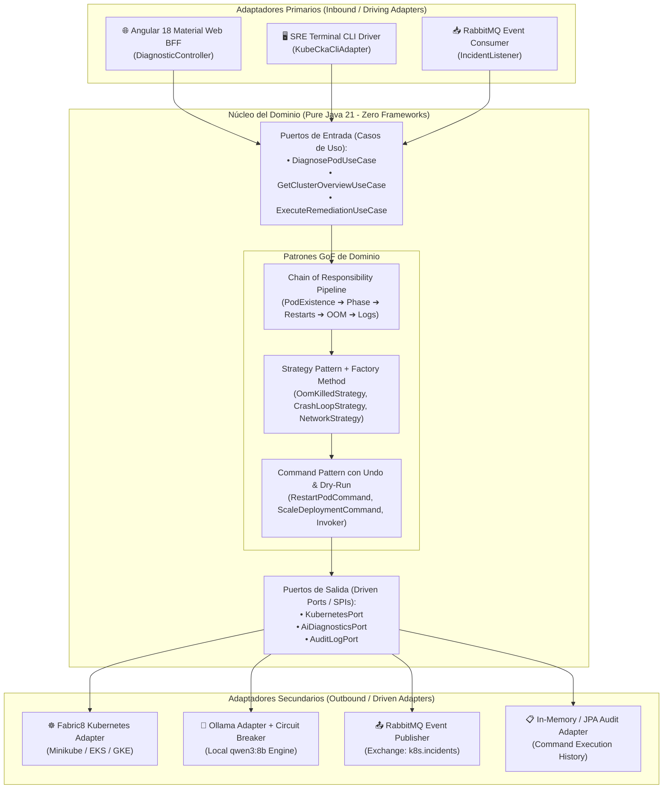

# 🧠 KubeSynapse AI
> **Cloud-Native Kubernetes Observability, SRE Troubleshooting Engine & Hexagonal Architecture**  
> *Diseñado y Arquitectado por **Juan Vargas** — Full Stack & Cloud-Native Developer*

[](https://openjdk.org/)
[](https://spring.io/projects/spring-boot)
[](https://material.angular.io/)
[](https://kubernetes.io/)
[](https://fabric8.io/)
[](https://www.rabbitmq.com/)
[](https://grafana.com/)
[]()
[](LICENSE)

---

## 📌 1. Visión y Propósito del Proyecto

**KubeSynapse AI** es un **Motor Autónomo de Observabilidad, AI-Ops e Ingeniería SRE** diseñado para diagnosticar, mitigar y operar incidentes críticos en clústeres de Kubernetes en tiempo real. Cierra la brecha entre los **Microservicios Java empresariales** y la **Administración Avanzada de Clústeres Kubernetes**.

En los entornos de producción modernos, la mayoría de los fallos de microservicios (`CrashLoopBackOff`, fugas de memoria con `OOMKilled 137`, cuellos de botella de pools de conexiones y fallas de resolución DNS de CoreDNS) generan fricción entre los equipos de Desarrollo (Dev) y los de Operaciones (Ops/SRE).

**KubeSynapse AI** actúa como un **Cerebro Supervisor Cloud-Native**:
1. Se conecta de forma nativa a la API Server de Kubernetes (`~/.kube/config`).
2. Ejecuta un triage multidimensional sin dependencias de infraestructura mediante **Arquitectura Hexagonal pura** y patrones **GoF**.
3. Consulta un modelo local de IA (**Ollama `qwen3:8b`**) aplicando el patrón de resiliencia **Circuit Breaker / Graceful Fallback**.
4. Expone sus capacidades a través de **múltiples adaptadores de entrada**: una interfaz reactiva en **Angular Material 18**, un driver de **Terminal CLI para operaciones SRE**, y un broker de eventos asíncronos con **RabbitMQ**.

---

## 🏛️ 2. Arquitectura del Sistema (C4 Model & Hexagonal Multi-Driver)

### Diagrama de Contexto y Arquitectura Hexagonal



---

## 🎯 3. El "Por Qué" de Cada Patrón (Defensa Técnica de Arquitectura)

| Patrón Implementado | Ubicación en el Código | ¿Por qué se eligió? (Problema que resuelve) | ¿Por qué NO una alternativa común? |
| :--- | :--- | :--- | :--- |
| **Arquitectura Hexagonal (Ports & Adapters)** | `com.juanvargas.kubesynapse.domain` | Desacopla 100% las reglas de negocio de los clientes (Angular/CLI) y de los proveedores (Minikube/Ollama). Permite testear el dominio con JUnit 5 puro en milisegundos. | Una arquitectura en capas tradicional acopla el código a `@RestController` y `@Entity`, haciendo imposible cambiar de infraestructura o correr vía CLI sin Spring. |
| **Chain of Responsibility** | `domain.pattern.chain.DiagnosticPipeline` | El triaje de fallas es secuencial y multidimensional: verificar existencia ➔ fase ➔ reinicios ➔ cgroup kernel OOM ➔ escaneo de logs. Cada eslabón examina una dimensión y frena en causas concluyentes. | Un método gigante con 20 `if/else` viola el Principio Abierto/Cerrado (OCP) y el Principio de Responsabilidad Única (SRP). |
| **Strategy Pattern** | `domain.pattern.strategy.DiagnosticStrategy` | Cada causa técnica (OOM, CrashLoop, Fallo de Base de Datos) requiere un algoritmo de deducción y un informe con severidad (`CRITICAL`, `WARNING`, `HEALTHY`) distinto. | Evita sentencias `switch(reason)` dispersas. Para soportar un nuevo fallo, solo se añade una nueva clase Strategy sin tocar las existentes. |
| **Factory Method** | `domain.pattern.strategy.factory.DiagnosticStrategyFactory` | Centraliza la resolución de la estrategia de diagnóstico adecuada en tiempo de ejecución a partir de los códigos del pipeline. | El cliente no necesita saber cómo instanciar ni configurar cada estrategia individual. |
| **Command con Undo y Dry-Run** | `domain.pattern.command.RemediationCommand` | Trata operaciones operativas de Kubernetes como objetos de primera clase. Permite simular acciones (**Dry-Run**) antes de alterar el clúster y revertir cambios (**Undo / Rollback**). | Invocar métodos directos `service.restartPod()` no permite guardar un historial de auditoría inmutable ni deshacer operaciones erróneas. |
| **Circuit Breaker & Graceful Fallback** | `infrastructure.adapter.out.ai.SpringAiDiagnosticsAdapter` | La inferencia de modelos LLM locales (Ollama `qwen3:8b`) en CPU puede tardar o sufrir por presión de RAM. El adaptador conmuta en milisegundos a un motor heurístico de alta disponibilidad. | Dejar una llamada síncrona sin timeout ni fallback bloquea los hilos del servidor Tomcat y provoca caídas en cascada (HTTP 504). |
| **Reactive Service Facade con RxJS** | `frontend/src/app/core/services/kubesynapse-api.service.ts` | Centraliza la comunicación HTTP y mantiene un único estado inmutable con `BehaviorSubject` y `shareReplay(1)` para toda la UI. | Inyectar `HttpClient` en múltiples componentes causa peticiones duplicadas y fugas de memoria (*memory leaks*). |

---

## ☸️ 4. Alineación con Estándares Cloud Native & Linux Foundation

Este proyecto fue diseñado siguiendo los estándares operacionales y mejores prácticas de troubleshooting de la **Cloud Native Computing Foundation (CNCF)** y la **Linux Foundation**:

1. **Troubleshooting de Cargas de Trabajo (Workload Debugging)**:
   - Diagnóstico automático de estados `CrashLoopBackOff` y `OOMKilled` (Exit Code 137).
   - Inspección programática de terminaciones anteriores (`lastTerminationState`), códigos de salida de contenedor y eventos del clúster.
2. **Arquitectura y Topología del Clúster**:
   - Mapeo de Nodos, Namespaces aislados por RBAC y verificación de componentes del Control Plane (`etcd`, `kube-apiserver`, `kube-scheduler`, `kube-controller-manager`).
3. **Almacenamiento y Persistencia**:
   - Manifiestos de prueba con `StorageClass`, `PersistentVolumeClaim` (PVC) y `StatefulSet`.
4. **Comprobación de Redes y DNS**:
   - Validación de resolución de nombres con CoreDNS y conectividad entre servicios.

---

## 🛠️ 5. Guía de Instalación y Ejecución Paso a Paso (Local)

### Prerrequisitos
- **Java 21 LTS** (`java --version`)
- **Maven 3.9+** (`mvn --version`)
- **Node.js 20+** y **npm** (`node --version`)
- **Minikube** y **kubectl** (`minikube status`)
- **Ollama** con modelo `qwen3:8b` (`ollama list`)

---

### Paso 1: Iniciar el Clúster Minikube
```powershell
minikube start
kubectl cluster-info
```

### Paso 2: Desplegar el Broker RabbitMQ en Minikube (Opcional)
```powershell
kubectl apply -f k8s/infrastructure/rabbitmq.yaml
```

### Paso 3: Asegurar que Ollama está Activo
```powershell
ollama run qwen3:8b "hola"
```

### Paso 4: Compilar y Ejecutar el Backend (Spring Boot 3)
```powershell
cd d:\Documents\Proyectos\kubesynapse-ai
mvn clean package -DskipTests
mvn spring-boot:run
```
*El backend quedará escuchando en `http://localhost:8080` y Swagger UI en `http://localhost:8080/swagger-ui.html`.*

---

### Paso 5: Ejecutar el Frontend Reactivo (Angular Material 18)
En una nueva terminal:
```powershell
cd d:\Documents\Proyectos\kubesynapse-ai\frontend
npm install --legacy-peer-deps
npm start
```
*Abre tu navegador en **`http://localhost:4200`** para interactuar con el Dashboard.*

---

### Paso 6: Demostración Multi-Cliente vía Terminal CLI (Modo Terminal Directo)
Sin necesidad de abrir el navegador, puedes ejecutar un diagnóstico directo desde la consola gracias a la Arquitectura Hexagonal:
```powershell
java -jar target/kubesynapse-ai-1.0.0-SNAPSHOT.jar --cli.pod=storage-provisioner --cli.namespace=kube-system
```

---

### Paso 7: Desplegar Pods con Fallas Controladas para Pruebas
Para ver al agente de IA y al pipeline en acción diagnosticando problemas reales:

#### Simular CrashLoopBackOff:
```powershell
kubectl apply -f k8s/samples/crashloop-pod.yaml
```

#### Simular OOMKilled (Memoria Excedida - Exit Code 137):
```powershell
kubectl apply -f k8s/samples/oomkilled-pod.yaml
```

*Refresca el dashboard en `http://localhost:4200` o presiona "Diagnosticar con IA" para ver el informe generado por Ollama y las recomendaciones correctivas.*

---

## 🧪 6. Suite de Pruebas Unitarias

El núcleo de dominio cuenta con 11 pruebas unitarias independientes ejecutadas con **JUnit 5 y Mockito**, sin levantar contextos pesados de Spring:

```powershell
mvn test
```

```
[INFO] Results:
[INFO] Tests run: 11, Failures: 0, Errors: 0, Skipped: 0
[INFO] BUILD SUCCESS
```

---

## 📚 7. Referencias Educativas y Bibliografía

* 📘 **Arquitectura Hexagonal**: [Alistair Cockburn (Original Article)](https://alistair.cockburn.us/hexagonal-architecture/)
* 🌐 **Patrones de Diseño GoF**: [Refactoring.Guru (Chain, Strategy, Command)](https://refactoring.guru/es/design-patterns)
* 🎓 **Cursos de Referencia**: Gabriel Chaldú (DevTalles / Udemy), MIW-UPM (Máster en Ingeniería Web - UPM)
* 🛡️ **Resiliencia en Software**: [Martin Fowler — Circuit Breaker Pattern](https://martinfowler.com/bliki/CircuitBreaker.html)
* 🤖 **Spring AI Framework**: [Official Spring AI Docs](https://docs.spring.io/spring-ai/reference/index.html)
* ☸️ **Estándares Cloud Native**: [Cloud Native Computing Foundation (CNCF)](https://www.cncf.io/)
* 🎨 **Angular Material M3**: [Angular Material Official Documentation](https://material.angular.io/)

---

## 📄 Licencia
Este proyecto fue desarrollado con fines educativos, de investigación y portfolio profesional bajo licencia **Apache 2.0**.
